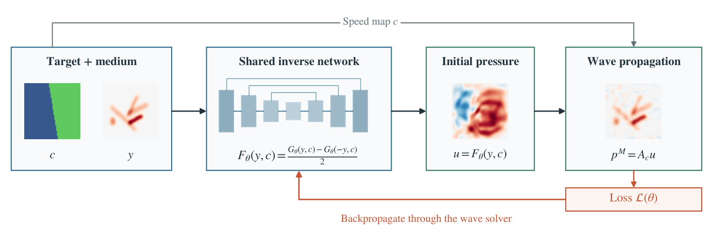

# JAX-WAVE

[](https://github.com/Honghui-Du/JAX-WAVE/actions/workflows/check.yml)
[](LICENSE)

Physics-supervised inverse wave design in heterogeneous media. JAX-WAVE maps a
target wave field and a wave-speed map to bounded initial-pressure controls.

[Paper](https://arxiv.org/abs/2611.13826) · [Usage](docs/REPRODUCING.md) · [Results](results/README.md)



## Quick start

Python 3.9 or later:

```bash
git clone https://github.com/Honghui-Du/JAX-WAVE.git
cd JAX-WAVE
python -m pip install -r requirements-analysis.txt
python scripts/reproduce.py verify
OPENBLAS_NUM_THREADS=1 python scripts/reproduce.py math
OPENBLAS_NUM_THREADS=1 python scripts/analyze_budget_benchmark.py
```

For training, checkpoint prediction and numerical inversion, install
`requirements-model.txt` and follow the [usage guide](docs/REPRODUCING.md).
Data and trained checkpoints are available in the
[data archive](https://drive.google.com/drive/folders/1YucW1H7JgKLcU9j8-GwHiVQ3OwmoBRg5).

## Files

| Directory | Contents |
| --- | --- |
| `jaxwave/` | Model, wave propagator, training, prediction and numerical solver |
| `results/` | Reported measurements, training curves and benchmark cases |
| `scripts/` | Data installation, numerical checks, statistics and plotting |
| `docs/` | Usage and licensing information |

## Citation

```bibtex
@misc{du2026jaxwave,
  author = {Du, Honghui and Guo, Binyao and Pan, Yushu},
  title = {{JAX-WAVE}: A Differentiable Physics-Supervised Framework
           for Inverse Wave Design in Heterogeneous Media},
  year = {2026},
  eprint = {2611.13826},
  archivePrefix = {arXiv},
  primaryClass = {cs.LG},
  doi = {10.48550/arXiv.2611.13826},
  url = {https://arxiv.org/abs/2611.13826}
}
```

## License and contact

Original software is released under the [MIT license](LICENSE).
See [licensing scope](docs/LICENSING.md) for research data and figures.
For issues, use the repository issue tracker. Contact: du000211@umn.edu.
